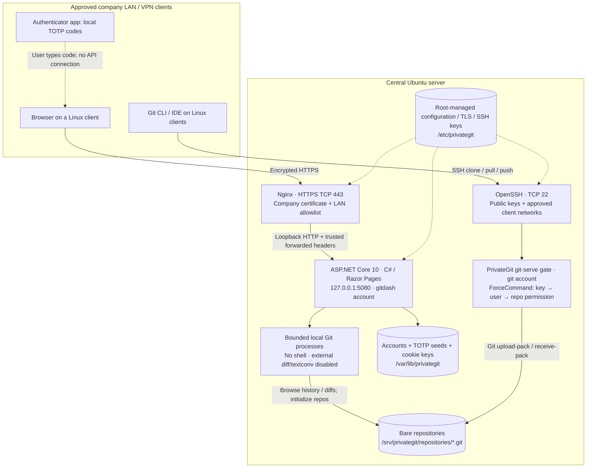
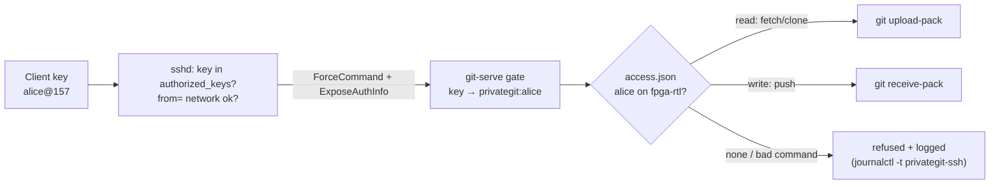
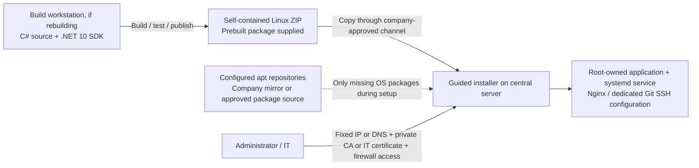

# PrivateGit system architecture

PrivateGit runs on one central Linux server inside the company network. The C# application provides the web interface. OpenSSH handles Git transport. Both operate on the same local bare Git repositories. No external application API, cloud identity provider, hosted Git service, CDN or analytics service is part of normal operation.

The initial deployment and test path is **Linux server + Linux clients**. Windows client access is optional and can be added later through the same HTTPS/SSH endpoints, with no server reinstallation. No Windows server, domain services, Windows runtime or Windows client is required for this setup.

## Runtime components and traffic

There are **two separate authentication paths**. Dashboard users sign in with a password plus TOTP. Git clients authenticate with individual SSH keys. Each SSH key is linked to one dashboard user, so the same per-repository permission (none / read / write) applies on both paths. The authenticator computes a code locally; the server verifies it using the stored seed.

## Responsibilities and boundaries

| Component | Responsibility | Access |
|---|---|---|
| Nginx | Company TLS certificate, HTTPS, web network allowlist and request limits | Public to approved company clients on 443; forwards only to loopback |
| ASP.NET Core | Authentication, roles, CSRF, source browsing, commits, diffs, comparisons, repository creation | `gitdash` service account; authenticated web access |
| Local Git subprocesses | Read objects/history, compute diffs and initialize bare repos | Fixed command structure, argument arrays, hash-based revisions, bounded time/output |
| OpenSSH + PrivateGit gate | Git clone, fetch/pull and push, after a per-user, per-repository permission check | Separate `git` account; public keys linked to users; ForceCommand; no shell or forwarding |
| Repository storage | Single authoritative remote for each project | Shared `gitrepos` group; independent working copies stay on clients |
| Account storage | Password hashes, TOTP seeds, lockouts, session revocation stamps, Data Protection keys | Private to `gitdash`; file-backed store supports one process |
| Administrator / IT | Firewall/routing, host patching, storage/backups and monitoring; optional DNS and CA (otherwise fixed IP + private PrivateGit CA) | Administrator access separate from the Git account |

Permissions are **per user and per repository**: Admins have full access. Users have none, read or write on each repository, stored in `/srv/privategit/access/access.json` (written by the dashboard, read by the SSH gate). There are no per-branch rules, pull-request review gates, separate release-asset storage or high-availability replicas.

## Request flows

1. **Browse / inspect changes:** browser → Nginx → C# authorization → local Git → escaped HTML back to browser. Source HTML/JavaScript is displayed as text, never executed. Commit IDs pin historical navigation.
2. **Create repository:** an authenticated Admin submits a CSRF-protected form → C# validates the name → Git initializes a bare `main` repository in a staging directory → the completed directory is moved into place.
3. **Push code:** client Git → OpenSSH public-key check → PrivateGit gate (key → user → write permission on that repository) → `git receive-pack` → bare repository refs/objects. Clone/fetch goes the same way and needs read permission. Pushing does not automatically update client working copies; clients pull. The dashboard sees updates on its next request/refresh.
4. **Inspect a version:** branch/tag selector → locally resolved commit hash → tree/history views. Commit diffs compare against a parent; merge commits allow parent selection. General comparisons show direct differences between two snapshots.

## Setup and updates

`install.sh --check` reads prerequisites only. Normal setup can download missing OS packages with permission; `--offline` forbids those downloads. `request-certificate.sh` generates a private key and certificate request locally. `add-client.sh` authorizes a public client key and applies source-network restrictions. None of these helpers uses an external application API.

The installer refuses unrelated existing identities/locations. Installer-owned reruns retain accounts and repositories, back up configuration/application files, validate Nginx/OpenSSH configuration before reloading, and perform a loopback application health check. On installation failure, prior configuration is restored and the dashboard is left stopped for correction/resume. Source-code/account backups are a separate operation.

## Deployment and operations

- **Application:** `/opt/privategit`, root-owned. Single self-contained executable; no .NET runtime installation on the server. Rebuild/redeploy for .NET runtime security updates.
- **Persistent state:** `/var/lib/privategit`, `/srv/privategit/repositories`, `/etc/privategit`. Preserve these across upgrades. Account TOTP seeds and Data Protection keys are not encrypted at rest; restrict file access and protect disks/backups.
- **Ports:** 443 for HTTPS; 22 for SSH; optional 80 for an HTTPS redirect. 5080 binds only to loopback. The installer does not replace host/network firewall policy.
- **Isolation:** separate service/SSH identities, restricted Git shell, systemd privilege/filesystem/task/memory limits, root-managed SSH authorization and TLS keys.
- **Observability:** application events in journald, SSH authentication in system logs, Nginx logs. This is not a tamper-proof per-ref Git audit system.
- **Backups:** coordinate both dashboard activity and SSH Git writes, or use a coordinated filesystem snapshot. Stopping the web app alone does not stop pushes. Test restoration.
- **Availability:** one central server and one web process. A server outage interrupts central Git access; clients can still work and commit locally, then push after recovery.
- **Network assurance:** the app has no external API dependency. Company IT should enforce permitted egress and manage OS services such as DNS, NTP and package updates separately.

## Validation status

The C# application test runner passes on Linux (and previously on the Windows development PC), and `scripts/test-ssh-gate.sh` verifies the permission gate end to end against a real OpenSSH server. Installer shell validation/rendering and certificate-helper checks are recorded in `TESTING.md`. The actual company Linux environment must still be verified for systemd, filesystem permissions, TLS trust, firewall/network allowlists, effective SSH policy and clone/push behavior. No claim of complete security or an independent audit is made.
