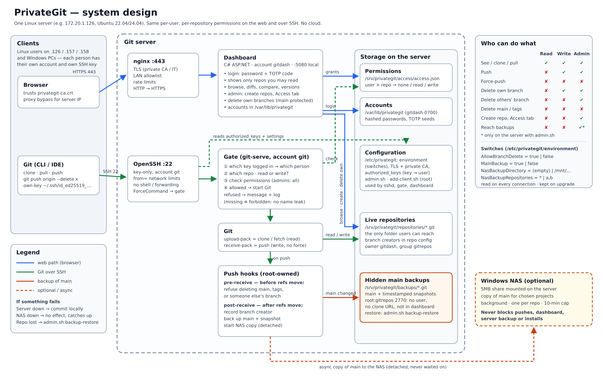
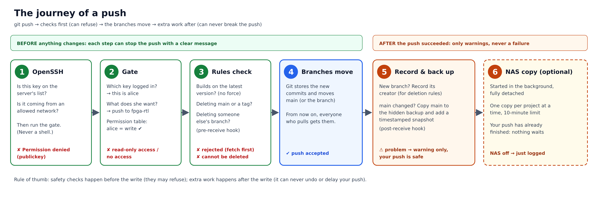

# PrivateGit: a private Git server for our lab, explained from the basics

*How it works, why it is built this way, and what each part is for.*

---

## About this document

This document explains a small, self-hosted Git server called **PrivateGit**. It was built for an engineering lab with three Linux servers and several engineers. It starts from first principles: what version control is, what a server adds, what SSH keys and certificates are. Each later section builds on the earlier ones. Every design decision is explained with *why*, not only *what*.

It is written to be read or turned into a video explanation. Section 16 suggests a structure for a video.

---

## 1. The problem we started with

Our lab has three Linux machines on the office network, at addresses **172.20.1.126**, **172.20.1.157** and **172.20.1.158**. Several engineers log in to each of them with their own Linux accounts. They write FPGA designs (Verilog/SystemVerilog, Vivado projects), DPU software (NVIDIA DOCA, C, CUDA), scripts and documentation.

Without a shared system, the usual problems appear:

- **Copies drift.** The "latest" version of a design lives in someone's home folder on one machine, and a slightly different copy lives on another.
- **History is lost.** When something breaks, nobody can say what changed, when, or by whom.
- **Overwrites happen.** Two people edit the same file and one silently replaces the other's work.
- **Access is all or nothing.** Either everyone can change everything, or files are emailed around.

The obvious answer is **Git** with a central server, like GitHub. But our environment has rules:

| Constraint | Consequence |
|---|---|
| Company policy: source code must stay on-premise; no cloud services | GitHub, GitLab.com and similar are not allowed |
| Corporate HTTP proxy for internet access | Anything internal must bypass the proxy |
| Servers run **Ubuntu 22.04** | The software must support it |
| No internal DNS names and no IT-issued certificates | Machines are reached by IP address; we must handle HTTPS ourselves |
| Different people need different access | Per-user, per-project permissions |
| Servers already run other important work | Installing must not break existing configuration |
| "Not too complicated" | Simple to run, simple to explain |

So the goal became: **a private, on-premise Git server with per-user permissions that is safe to install on an existing lab server and simple to operate.**

---

## 2. Basic concept: what Git does

### 2.1 Version control

A **version control system** records the history of a set of files. Each time you save a meaningful step, you make a **commit**: a snapshot of all files, plus a message, an author and a time. Commits form a chain, so you can always see what changed, go back to an earlier state, or compare two states.

### 2.2 Git is distributed

Git is *distributed*: every person has a **complete copy** of the project and its whole history on their own machine (a **clone**). You can commit, browse history and compare versions without any network.

To share work, people exchange commits with a common copy:

- **push** sends your new commits to the shared copy;
- **pull** (or **fetch**) brings other people's new commits to you.

### 2.3 Branches and the main branch

A **branch** is a named line of development: a movable label that points at the latest commit of that line. Every project has a primary branch, called **main**, which holds the agreed, current version. People create other branches (`feature-x`, `alice-uart-fix`) to try things without disturbing main, then merge them in.

### 2.4 Pushes, fast-forwards and conflicts

A shared copy should only accept a push that **builds on top of** what it already has. That is called a *fast-forward*. If someone else pushed first, your push is rejected: you must pull their work, combine it with yours, and push again. Git merges changes in different files, or different lines of the same file, automatically. Only edits to the *same lines* create a **conflict** that a person must resolve.

A **force-push** throws away the server's history and replaces it with yours. It is useful for one person, but dangerous on a shared project, because it can erase other people's work.

> **Hardware analogy.** A normal push is a *compare-and-swap*: the write succeeds only if you based it on the current value. A force-push is an unconditional write that ignores what is there.

### 2.5 Why a central server is still needed

Even though Git is distributed, a team needs **one agreed meeting point**, a "single source of truth". It must always be online, it decides who may read and write, it keeps the official main branch, and it is where backups are taken. On a server, this shared copy is stored as a **bare repository**: Git's database without a working folder, because nobody edits files directly on the server.

---

## 3. Basic concepts: identity, access and secure connections

### 3.1 Authentication vs authorization

Two different questions must be answered for every request:

- **Authentication**: *who are you?* (password, key, code)
- **Authorization**: *what are you allowed to do?* (read this project, write that one)

A good design keeps them separate and answers both every time.

### 3.2 SSH and SSH keys (how Git talks to the server)

**SSH** (Secure Shell) is the standard encrypted way to connect to a Linux server. Git can use SSH to clone, pull and push.

Instead of passwords, SSH uses a **key pair**:

- the **private key** stays on the person's computer and is never shared;
- the **public key** is given to the server.

When connecting, the computer proves that it holds the private key that matches a public key the server knows, without ever sending the private key. It is like a lock (the public key) installed on the server, and a key that only you hold. The server keeps the list of accepted public keys in a file called **authorized_keys**.

Keys are better than passwords for Git: they can't be guessed, are not typed every time, and can be revoked one by one.

### 3.3 HTTPS, certificates and certificate authorities (how the browser talks to the server)

The web dashboard uses **HTTPS**: web traffic encrypted with **TLS**. To prevent impersonation, the server presents a **certificate**, a signed statement that says, "this key belongs to 172.20.1.126". The browser accepts it only if it is signed by a **certificate authority (CA)** that the browser trusts.

Companies usually get certificates from IT. In our lab there was no IT certificate and no DNS name. So PrivateGit creates its **own small private CA** on the server, signs its certificate for the server's IP address, and each client trusts that CA once. This is safe and offline, and it affects nothing else on the machine: the CA belongs only to PrivateGit.

### 3.4 Two-factor login (TOTP)

The dashboard requires a **password plus a six-digit code** from an authenticator app. The code is computed from a shared secret and the current time, and changes every 30 seconds (the TOTP standard, RFC 6238). Someone who steals a password still cannot log in without the phone. The server also refuses to accept the same code twice.

### 3.5 Reverse proxy

A **reverse proxy** is a front door that receives web requests and forwards them to the real application. PrivateGit uses **nginx** for this. nginx handles the encryption, the network allowlist and rate limits. The PrivateGit application itself listens only on the server's internal address (127.0.0.1), so it can never be reached directly from the network.

### 3.6 Linux accounts, groups and least privilege

Linux controls access to files with **users**, **groups** and **permissions** (read, write, execute). Good practice is **least privilege**: every program runs under its own account, with only the access it needs. If one part is compromised, the damage stays contained. PrivateGit uses separate service accounts for its web part and its Git part, a shared group for repository files, and root-only files for secrets.

### 3.7 Git hooks

A **hook** is a small program Git runs automatically at certain moments. Two matter here:

- **pre-receive** runs *before* a push changes anything, and can **refuse** it;
- **post-receive** runs *after* a push succeeded, and can do follow-up work, but cannot undo the push.

> **Hardware analogy.** pre-receive is a validity check before a register write is committed; post-receive is logic triggered after the write.

---

## 4. Where we started and what had to change

PrivateGit already existed as a small C# (ASP.NET Core) web application that shows repositories, history and diffs, plus an installer. The original version had important gaps for our use:

| Original behaviour | Problem for us |
|---|---|
| Every dashboard user could read every repository | No per-person or per-project privacy |
| Every SSH key could read **and write** every repository | Anyone with access could change any project |
| Installer only for Ubuntu 24.04 | Our servers run 22.04 |
| Required an internal DNS name and an IT certificate | We have neither |
| Pushes of dashboard-created repositories failed on modern Git | A hidden bug (see section 13) |

Alternatives were considered (section 14). The decision was to **extend PrivateGit** rather than adopt a large external product, because company policy discourages relying on outside tools. All changes were written and tested in-house.

---

## 5. From needs to design decisions

| Need | Decision | Why |
|---|---|---|
| Keep code on-premise | Self-hosted on a lab server, no cloud calls | Policy; full control |
| One meeting point | One server (recommended: .126) holds bare repositories | Simple; other machines are clients |
| Per-user, per-project access | Permission table: each user has *none*, *read* or *write* per repository; admins have full access | Matches how teams actually share |
| Same rules for web and Git | One permission file used by both the dashboard and the SSH gate | No way around the rules by switching tools |
| Know who is pushing | Each SSH key is linked to exactly one person | Keys become identities, not shared passwords |
| Nobody can run arbitrary commands | SSH forces every connection through a "gate" program | The Git account can never open a shell |
| Protect shared history | Force-push refused; main branch and tags cannot be deleted | Prevents accidental or deliberate erasure |
| Tidy up branches safely | People may delete **only branches they created**; admins any | Freedom without stepping on others |
| Never lose main | Hidden backup of main with timestamped snapshots after every change | Recovery from mistakes and disasters |
| Optional copy on the Windows NAS | Background copy that can never block anything | Extra safety without new failure points |
| No DNS, no IT certificate | Reach the server by IP; private CA option | Works in our network today |
| Don't break existing servers | Installer refuses conflicts, validates, rolls back, keeps settings on upgrade | Safe to install next to other work |
| Simple | One server, plain Git workflow, a few admin commands | Easy to learn and explain |

---

## 6. The architecture at a glance



The server has two entrances and one set of rules:

1. **The web entrance (blue in the diagram).** Browser → nginx (HTTPS) → the **Dashboard** application. Used to browse code, view history and diffs, manage access (admins), and delete your own branches.
2. **The Git entrance (green).** Git client → **OpenSSH** → the **Gate** → Git itself. Used to clone, pull and push.

Both entrances read the same **permission table**. Behind them is **storage**: the live repositories, the permission file, user accounts, configuration, and the **hidden backups (orange)**. An optional **Windows NAS** receives a background copy of main.

### 6.1 The components

| Component | Runs as | What it does |
|---|---|---|
| **nginx** | system | HTTPS front door: encryption, network allowlist, rate limits, redirect from HTTP |
| **Dashboard** | account `gitdash` | Login with password + code; shows only repositories you may read; browse, diffs, compare, versions; admins create repositories and set access; users delete their own branches |
| **OpenSSH** | system → account `git` | Accepts only known keys from allowed networks; always runs the gate; no shell, no port forwarding |
| **Gate** (`git-serve`) | account `git` | Finds out *which person* connected (from the key), *which repository* and *read or write*; checks the permission table; starts Git only if allowed |
| **Git** (`upload-pack`, `receive-pack`) | account `git` | Sends data for clone/fetch, receives pushes |
| **pre-receive hook** | account `git`, file owned by root | Refuses deleting main, tags, or someone else's branch |
| **post-receive hook** | account `git`, file owned by root | Records who created each new branch; backs up main; starts the NAS copy |
| **admin.sh / add-client.sh** | root | Administrator tools: users, permissions, SSH keys, backups |

### 6.2 Where things are stored

| Location | Contents | Who can access |
|---|---|---|
| `/srv/privategit/repositories/*.git` | Live repositories (the only thing users reach) | Through the gate/dashboard, per permissions |
| `/srv/privategit/access/access.json` | Who may read/write which repository | Dashboard writes; gate reads |
| `/srv/privategit/backups/*.git` | Hidden backups of main with snapshots | No user; root and service accounts only |
| `/var/lib/privategit` | Dashboard accounts (hashed passwords, 2FA secrets) | Dashboard account only |
| `/etc/privategit` | Settings, certificates and CA, list of SSH keys | Root (some files readable by the service group) |


### 6.3 Inside nginx (the web front door)

**What nginx is.** nginx ("engine-x") is a widely used web server. Here it works only as a **reverse proxy**: it takes encrypted requests from browsers, checks them, and passes allowed ones to the PrivateGit dashboard running privately on the same machine. It keeps the dashboard away from the network and adds protections in one well-tested place.

**Where its settings live.** On Ubuntu, each website is one file in `/etc/nginx/sites-available/`, switched on by a link in `/etc/nginx/sites-enabled/`. PrivateGit adds exactly one file, `privategit`, and leaves every other site alone.

**The PrivateGit site file, line by line** (shown for the server 172.20.1.126):

```nginx
limit_req_zone $binary_remote_addr zone=privategit_general:10m rate=10r/s;
limit_req_zone $binary_remote_addr zone=privategit_login:10m  rate=5r/m;

server {                                   # plain HTTP on port 80
    listen 80;
    server_name 172.20.1.126;
    if ($host != 172.20.1.126) { return 444; }
    return 301 https://172.20.1.126$request_uri;
}
server {                                   # HTTPS on port 443
    listen 443 ssl;
    server_name 172.20.1.126;
    if ($host != 172.20.1.126) { return 444; }
    ssl_certificate     /etc/privategit/tls/fullchain.pem;
    ssl_certificate_key /etc/privategit/tls/privkey.pem;
    ssl_protocols TLSv1.2 TLSv1.3;
    server_tokens off;
    client_max_body_size 16k;
    allow 172.20.1.0/24;
    deny all;
    location = /Login { limit_req zone=privategit_login burst=5 nodelay;  proxy_pass http://127.0.0.1:5080; ... }
    location ~ ^/(site|history)\.css$ {                                  proxy_pass http://127.0.0.1:5080; ... }
    location / {       limit_req zone=privategit_general burst=40 nodelay; proxy_pass http://127.0.0.1:5080; ... }
}
```

| Line | What it means | Why it is there |
|---|---|---|
| `limit_req_zone … rate=10r/s` / `rate=5r/m` | Counts requests per client address: about 10 per second for normal pages, 5 per minute for the login page | Slows down password guessing and runaway scripts |
| `listen 80` + `return 301 https://…` | Anyone typing `http://` is redirected to `https://` | Passwords never travel unencrypted |
| `server_name` + `if ($host != …) return 444` | Answers only requests addressed to the server's own name/IP; otherwise closes the connection silently | Ignores scans and requests meant for other sites |
| `listen 443 ssl`, `ssl_certificate…` | Turns on TLS encryption with PrivateGit's certificate and key | The browser can verify it is talking to the real server |
| `ssl_protocols TLSv1.2 TLSv1.3` | Only modern encryption versions | Old, weak versions are refused |
| `server_tokens off` | Hides the nginx version number | Gives attackers less information |
| `client_max_body_size 16k` | Requests may carry at most 16 KB | The dashboard only has small forms; big uploads are refused |
| `allow 172.20.1.0/24; deny all;` | Only machines in the lab network may connect | A second wall in addition to the network firewall |
| `location = /Login { limit_req … }` | Strict limit on the login page | Brute-force protection |
| `location ~ …\.css$` | The two stylesheets are not rate-limited | Normal browsing never hits the limit (a bug found in testing) |
| `proxy_pass http://127.0.0.1:5080` | Forward the request to the dashboard, which listens only inside the machine | The application is never directly exposed |
| `proxy_set_header X-Forwarded-For / -Proto` | Tells the dashboard the real client address and that the request was HTTPS | Correct logging and secure cookies |

**How a web request travels:** browser → port 443 → nginx checks network, hostname and rate → decrypts → forwards to 127.0.0.1:5080 → the dashboard checks login and permissions → the answer goes back through nginx, encrypted.

**nginx commands an admin uses:**

| Command | Purpose |
|---|---|
| `sudo nginx -t` | Check that all nginx settings are valid **before** applying them |
| `sudo systemctl reload nginx` | Apply new settings without dropping current visitors |
| `systemctl status nginx` | Is nginx running? |
| `ls /etc/nginx/sites-enabled/` | Which sites are switched on |
| `sudo tail -f /var/log/nginx/access.log` | Watch requests arrive (429 = rate-limited, 403 = blocked network) |
| `sudo tail /var/log/nginx/error.log` | Configuration or connection errors |

### 6.4 Inside SSH (the Git front door)

**Two programs.** **`sshd`** is the SSH *server* running on the Git server. **`ssh`** is the *client* each person runs (Git calls it automatically when you clone or push over SSH).

**Step 1: each person makes a key pair** (once per person, per machine):

```bash
ssh-keygen -t ed25519 -f ~/.ssh/id_ed25519_privategit -C "alice@157"
```

| Part | Meaning |
|---|---|
| `-t ed25519` | Modern, short, very strong key type |
| `-f ~/.ssh/id_ed25519_privategit` | File name. This creates two files: the **private** key (no extension, never shared) and the **public** key (`.pub`, sent to the admin) |
| `-C "alice@157"` | A label so people can tell keys apart |

**Step 2: the admin links the public key to the person:**

```bash
sudo bash /opt/privategit/add-client.sh alice /tmp/alice-157.pub --from 172.20.1.157/32
```

This adds one line to the server's key list, `/etc/privategit/authorized_keys`:

```text
from="172.20.1.157/32",restrict ssh-ed25519 AAAAC3Nza…  privategit:alice alice@157
```

| Part | Meaning |
|---|---|
| `from="172.20.1.157/32"` | This key only works when connecting **from** that machine (or the allowed network) |
| `restrict` | Turns off everything optional for this key: no terminal, no port forwarding, no agent forwarding |
| `ssh-ed25519 AAAA…` | The public key itself |
| `privategit:alice` | PrivateGit's marker: this key belongs to the person **alice** |

**Step 3: each person tells their SSH client how to reach the server.** This goes in `~/.ssh/config`:

```sshconfig
Host privategit 172.20.1.126
    HostName 172.20.1.126
    User git
    IdentityFile ~/.ssh/id_ed25519_privategit
    IdentitiesOnly yes
```

| Line | Meaning |
|---|---|
| `Host privategit 172.20.1.126` | A nickname: `git clone privategit:fpga-rtl.git` now works |
| `HostName` | The real address to connect to |
| `User git` | Everyone connects as the shared service account **git**; the server tells people apart by their **key**, not by this name |
| `IdentityFile` | Which private key to use |
| `IdentitiesOnly yes` | Offer only that key, not every key on the machine |

On the first connection SSH shows the **server's fingerprint** and asks whether to trust it. Compare it with the one the admin received from the installer, then answer yes. It is stored in `~/.ssh/known_hosts`, so SSH can warn if a different machine ever pretends to be the server.

**Step 4: the server's SSH rules for the git account.** The installer adds one file, `/etc/ssh/sshd_config.d/60-privategit.conf`. Everything inside `Match User git` applies **only** to the git account; administrators' and other users' SSH logins are untouched.

```sshconfig
Match User git
    AllowUsers git@172.20.1.0/24
    AuthenticationMethods publickey
    PasswordAuthentication no
    KbdInteractiveAuthentication no
    AuthorizedKeysFile /etc/privategit/authorized_keys
    DisableForwarding yes
    PermitTTY no
    PermitUserRC no
    X11Forwarding no
    ExposeAuthInfo yes
    ForceCommand /opt/privategit/PrivateGit git-serve --config /etc/privategit/environment
    AcceptEnv GIT_PROTOCOL
Match all
```

| Line | Meaning | Why |
|---|---|---|
| `Match User git` … `Match all` | These rules apply only to the git account | Never changes how admins log in |
| `AllowUsers git@172.20.1.0/24` | The git account is accepted only from the lab network | Network wall |
| `AuthenticationMethods publickey`, `PasswordAuthentication no` | Keys only, never passwords | Nothing to guess |
| `AuthorizedKeysFile /etc/privategit/authorized_keys` | Use PrivateGit's root-owned key list | Users can't add keys themselves |
| `DisableForwarding`, `X11Forwarding no` | No tunnels or forwarded windows | The connection can't be used to reach other machines |
| `PermitTTY no`, `PermitUserRC no` | No interactive terminal, no login scripts | No way to get a shell |
| `ExposeAuthInfo yes` | Tells the gate exactly which key just logged in | This is how the gate knows who the person is |
| `ForceCommand … git-serve` | Whatever the client asks for, sshd runs **the gate** instead | One forced path: only permitted Git operations are possible |
| `AcceptEnv GIT_PROTOCOL` | Allows Git's faster protocol version | Performance |

**What happens when you type `git push`:**

1. Git runs `ssh git@172.20.1.126 "git-receive-pack 'fpga-rtl.git'"` behind the scenes.
2. `sshd` checks the network and the key.
3. Instead of running that command, sshd runs **the gate**, and hands it the requested command (in a variable called `SSH_ORIGINAL_COMMAND`) plus the key that was used.
4. The gate parses the request: service = *receive-pack* (a push, which needs write); repository = *fpga-rtl*. Anything else (`bash`, `cat /etc/passwd`, `scp`, paths like `../`) is refused.
5. The key maps to **alice**; the permission table says alice has write, so the gate starts Git's receive-pack. Pack data then flows directly between your Git and the server's Git.

Typing `ssh privategit` alone just prints `Hi alice. Interactive shells are disabled; use git clone/pull/push.`, which is a handy way to check that your key works.

**SSH commands an admin uses:**

| Command | Purpose |
|---|---|
| `sudo sshd -t` | Check SSH settings for errors **before** applying them |
| `sudo sshd -T -C user=git,host=x,addr=172.20.1.157 \| grep -E 'forcecommand\|permittty'` | Show the *effective* rules for the git account from a given address |
| `sudo systemctl reload ssh` | Apply settings without disconnecting anyone |
| `sudo ssh-keygen -lf /etc/ssh/ssh_host_ed25519_key.pub` | Show the server fingerprint to give to users |
| `sudo bash /opt/privategit/add-client.sh --list` | Which person owns which key |
| `journalctl -t privategit-ssh` | Who cloned, pushed or deleted what, and what was refused |

---

## 7. How things flow

### 7.1 Logging in to the dashboard

1. The browser opens `https://172.20.1.126`. nginx checks that the request comes from an allowed network, and the certificate proves it is the real server.
2. The user enters username, password and the six-digit code. Five wrong attempts lock the account for 15 minutes.
3. The dashboard shows **only** the repositories that user may read. Repositories they may not read return "not found", so even their names stay hidden.

### 7.2 Cloning or pulling

1. `git clone git@172.20.1.126:fpga-rtl.git`
2. OpenSSH checks the key and the network, then runs the gate (never a shell).
3. The gate identifies the person from the key that just logged in, sees "read fpga-rtl", checks the permission table, and starts Git's sending side.

### 7.3 The journey of a push



| Step | Where | Can stop the push? |
|---|---|---|
| 1. Key known, allowed network | OpenSSH | Yes: "Permission denied (publickey)" |
| 2. Key → person; person has **write** on this repository | Gate | Yes: "read-only access" / "no access" |
| 3. No force-push; no deleting main, tags or someone else's branch | Git settings + pre-receive hook | Yes, with a clear message |
| 4. The branches move to the new commits | Git | — |
| 5. Record branch creator; back up main with a snapshot | post-receive hook | No: problems only produce a warning |
| 6. Copy main to the NAS (if enabled) | Detached background job | No: never waited on |

The key property: **steps 1–3 can refuse, steps 5–6 can never break a push.** Safety checks come before the write; extra work comes after it and is never in the way.

### 7.4 What a refusal looks like

People get plain messages, for example:
- `PrivateGit: bob has read-only access to fpga-rtl. Ask the administrator for write access.`
- `PrivateGit: Repository 'x' not found or trainee1 has no access.` (identical for "missing" and "forbidden", so names are not revealed)
- `PrivateGit: the main branch (main) cannot be deleted.`
- `PrivateGit: branch x was created by alice. Only its creator or an administrator can delete it.`

---

## 8. The permission model

| Action | Read user | Write user | Admin |
|---|---|---|---|
| See, clone, pull | ✔ | ✔ | ✔ (all repositories) |
| Push | ✘ | ✔ | ✔ |
| Force-push (rewrite history) | ✘ | ✘ | ✘ |
| Delete a branch they created | ✘ | ✔ | ✔ |
| Delete someone else's branch | ✘ | ✘ | ✔ |
| Delete main or tags | ✘ | ✘ | ✘ |
| Create repositories, manage access | ✘ | ✘ | ✔ |
| See or reach the backups | ✘ | ✘ | Only on the server with admin tools |

**How keys become people.** When the admin links a key with `add-client.sh alice alice.pub`, the server's key list gets a line that ends with `privategit:alice`. When someone connects, OpenSSH tells the gate exactly which key was used, and the gate looks up the person. A key can belong to only one person, and an optional `--from` limit can tie a key to one machine (for example only from .157).

**Several users on one machine.** Each Linux user has their own private key in their own home folder, so `alice` and `bob` on .157 are different people to the server. A shared Linux account would make everyone using it the same person, so separate Linux accounts are recommended.

**Branch ownership.** When someone pushes a new branch, the post-receive hook records them as its creator inside the repository's settings. The dashboard shows "created by alice", and only she (or an admin) can delete it. Branches that existed before this feature have no recorded creator, so only admins can delete them.

---

## 9. Security design in plain words

| Principle | How it is applied |
|---|---|
| **One forced path** | Every SSH connection to the Git account runs the gate. There is no shell, no file copying, no port forwarding, and no other command, even if someone tries |
| **Separate accounts** | The web part (`gitdash`) and the Git part (`git`) are different users. Secrets (passwords, 2FA seeds, certificate keys) are readable only by the account that needs them |
| **Don't leak names** | A missing repository and a forbidden one look the same |
| **Defense in depth** | Network allowlist (nginx and SSH), keys, 2FA, permission checks, protected branches, rate limits |
| **Safe web pages** | Repository content is always shown as text, never executed; forms are protected against cross-site tricks; strict security headers |
| **Fail safe** | If the branch-protection hook were missing, deletion is turned off automatically instead of becoming unprotected |
| **Audit trail** | Every allowed or refused clone, push and branch deletion is logged with person, repository and client address |

---

## 10. Backups and recovery

### 10.1 The hidden backup of main

After every push that changes main, the server copies main into a separate backup area (`/srv/privategit/backups`) and records a **timestamped snapshot**. Snapshots are cheap, because they only point at commits that already exist, so every past version of main stays available.

It is **hidden**: not in the dashboard, not reachable through any clone address (not even for admins), and normal Linux users cannot list the folder. It is **harmless**: if the backup fails, the push still succeeds with a warning.

### 10.2 Recovery, step by step

| Situation | Admin command | Result |
|---|---|---|
| See all versions of main | `admin.sh backup-list fpga-rtl` | List of snapshots with commit messages |
| Someone pushed a bad change to main | `admin.sh backup-restore fpga-rtl <snapshot>` | The good version returns as a **new branch**; main is not changed, so nothing is overwritten without review |
| The repository was deleted or damaged | `admin.sh backup-restore fpga-rtl` | The repository is recreated from the backup, and existing permissions apply again |

### 10.3 The optional Windows NAS copy

The lab has a Windows NAS where files are stored. PrivateGit can **copy main to the NAS** as well (for all projects or chosen ones). The NAS is mounted on the Git server as a network share.

The NAS is only a *copy*, never the live storage, because:
- Git's file locking is not reliable over Windows file shares;
- if the live data lived on the NAS, a sleeping or offline NAS would stop everyone's work.

The rule is that **the NAS can never block anything**:

| If the NAS is… | Effect |
|---|---|
| Off, asleep or slow | Pushes, dashboard and server backups continue normally. The NAS copy runs fully detached, at most one per repository at a time, with a 10-minute limit |
| Unreachable during admin commands | Checked for up to 10 seconds, then skipped |
| Unreachable during install or upgrade | Never touched |
| Unreachable at boot | Mount options let the server start normally |

> **Hardware analogy.** The NAS copy is an asynchronous FIFO into a slow clock domain: the main path never stalls waiting for it.

### 10.4 Switches

Everything can be turned off in one settings file, `/etc/privategit/environment`, and changes apply on the next connection:

| Setting | Default | Meaning |
|---|---|---|
| `PrivateGit__MainBackup` | `true` | `false` turns off all backups (server and NAS) |
| `PrivateGit__NasBackupDirectory` | empty | Path of the mounted NAS share; empty = no NAS copy |
| `PrivateGit__NasBackupRepositories` | `*` | Which projects get the NAS copy |
| `PrivateGit__AllowBranchDelete` | `true` | `false` = nobody can delete branches |

---

## 11. Working together day to day

**Conflicts are handled by Git on each person's machine, not by the server.** The server only protects history. The team rules are simple:

| Rule | Why |
|---|---|
| Work on main; branch only for longer or risky work | Little branch management |
| Pull before you start; commit and push small changes often | Small differences mean rare, easy conflicts |
| Never commit generated outputs (bitstreams, build folders) | They cannot be merged and are rebuilt anyway |
| Keep Vivado projects as Tcl scripts plus sources | Text merges cleanly; project files do not |
| One owner at a time for block designs and IP files | Git cannot merge them safely |

**Project templates** are installed on the server and copied into each new project:
- a `.gitignore` for FPGA work (Vivado, Vitis, HLS, PetaLinux, simulators, MATLAB) and one for DOCA/C/CUDA work, which ignore build outputs, environment and secret files (`.env`, keys) and Python environments;
- a `.gitattributes` that keeps the same line endings for Linux and Windows, marks binary files, and makes Git **stop and ask** instead of silently auto-merging block design files.

---

## 12. Installing and operating safely

**Choosing the server.** Any of the three machines can run PrivateGit. **.126** is recommended because it is the most stable; .157/.158 are DPU lab machines that are often reconfigured and rebooted.

**What the installer changes, and how it protects the existing system:**

| Area | Change | Protection |
|---|---|---|
| Accounts | Adds `git`, `gitdash`, group `gitrepos` | Stops if they already exist |
| Folders | Its own folders under `/opt`, `/etc`, `/var/lib`, `/srv` | Stops if they exist and aren't its own |
| Web server | Adds one nginx site | Other sites untouched; stops if another program uses port 443; validates before reloading |
| SSH | Adds one settings file that applies **only** to the `git` account | Other users' SSH unaffected; validated; reloaded without disconnecting anyone |
| Service | Runs the dashboard on 127.0.0.1:5080 | Stops if the port is in use |
| Failure part-way | Restores previous configuration automatically | Keeps a backup copy |
| Upgrade | Rerun the installer | Keeps users, keys, permissions, repositories and your settings |

The private CA (from section 3.3) is created inside PrivateGit's own folder. It does not change the system's trusted certificates or any other service.

**Daily administration** uses two commands:

- `admin.sh`: add, reset and remove users; grant or revoke access; list and restore backups;
- `add-client.sh`: link a person's SSH key; list keys; revoke keys.


### 12.1 Terminal commands you will use

**For everyone (on your own Linux account):**

| Task | Command |
|---|---|
| Check your key works | `ssh privategit` → "Hi alice…" |
| Get a project | `git clone privategit:fpga-rtl.git` |
| Get others' latest work | `git pull` (with `git config --global pull.rebase true` set once) |
| See what you changed | `git status`, `git diff` |
| Save a step | `git add -A` then `git commit -m "Describe the change"` |
| Share it | `git push` |
| Start a side branch | `git switch -c alice-uart-fix` then `git push -u origin alice-uart-fix` |
| Delete your finished branch | `git push origin --delete alice-uart-fix` |
| See history | `git log --oneline --graph` |

**For administrators (on the Git server, with sudo):**

| Task | Command |
|---|---|
| Add a person (dashboard login) | `sudo bash /opt/privategit/admin.sh user-add alice User` |
| Link their SSH key | `sudo bash /opt/privategit/add-client.sh alice /tmp/alice.pub` |
| Grant access | `sudo bash /opt/privategit/admin.sh access-grant fpga-rtl alice write` |
| See who has what | `sudo bash /opt/privategit/admin.sh access-list` |
| Remove a person completely | `sudo bash /opt/privategit/admin.sh user-delete alice` |
| List / restore backups of main | `admin.sh backup-list fpga-rtl`, `admin.sh backup-restore fpga-rtl [snapshot]` |
| Check services | `systemctl status privategit nginx ssh` |
| Read logs | `journalctl -u privategit` (dashboard), `journalctl -t privategit-ssh` (Git) |
| Test the web entrance | `curl --noproxy '*' --cacert /opt/privategit/privategit-ca.crt https://172.20.1.126/Login -o /dev/null -w '%{http_code}\n'` → 200 |

`sudo` runs one command as administrator. `systemctl` starts, stops and reloads services. `journalctl` shows their logs.

---

## 13. How it was tested, and what testing found

Testing used several layers:

| Layer | What it covers | Result |
|---|---|---|
| Application test suite | Logins, 2FA, permissions, branch deletion rules, input attacks, page safety | 165 checks pass |
| SSH end-to-end test | A real SSH server, real Linux users, real clone/push/delete; injection and forwarding attempts; backups; a simulated hung NAS | 51 checks pass |
| Installer tests | Address and network validation, certificate creation, config rendering, settings kept on upgrade | 128 checks pass |
| Full installation | The real installer run end to end, then people working through the browser and Git | Works, including upgrade and recovery |

Testing found real problems before they reached the office:

1. **"Dubious ownership".** Repositories created by the dashboard account could not be cloned or pushed over SSH, because modern Git refuses repositories owned by a different user. The gate now marks only the single repository it has just authorized as safe.
2. **Rate limiting too strict.** Fast browsing hit nginx's request limit because stylesheets counted against it. Stylesheets are now exempt.
3. **Backup copy blocked by the same safety check.** Git drops command-line settings when fetching from a local path, so the backup copy failed. Fixed by passing the setting directly to that step.
4. **A pattern-matching edge case** in key ownership (two markers on one line) was caught by a test and fixed.

The lesson: test the way the system is really used. Bug 1 only appeared when repositories were created by the dashboard account, exactly as in production.

---

## 14. Alternatives that were considered

| Option | Strengths | Why not chosen |
|---|---|---|
| GitHub / GitLab.com | Full-featured | Cloud; not allowed by policy |
| Forgejo / Gitea (self-hosted) | Mature, per-repo permissions, web UI | Large external product; policy preference for in-house tools |
| Gitolite | Small, strong SSH permissions | No web dashboard; another tool to learn |
| Plain shared folder of bare repositories | Simplest possible | No permissions per person, no dashboard, no protection |
| **Extend PrivateGit** | Small, understood code; same C#/.NET skills as other lab tools; fits our constraints exactly | **Chosen** |

---

## 15. Limits (what it deliberately does not do)

- No pull requests or code-review workflow in the browser; merging happens in Git on each machine.
- Permissions are per user and per repository. There are no per-branch rules beyond the protected main branch, and no user groups.
- One server; if it is down, people keep working locally and push later.
- The NAS holds a copy of main, not the live repositories. The real SMB mount still needs checking on the actual network.
- Backups cover main only. A full server backup (accounts, other branches, settings) is still recommended.

---

## 16. Suggested structure for a video

1. **The problem** (section 1): scattered copies, lost history, policy says no cloud.
2. **Git in two minutes** (section 2): commits, branches, push/pull, why a central server.
3. **Who are you, what may you do** (sections 3.1–3.4): keys as identity, certificates, two-factor login.
4. **The big picture** (section 6 diagram): two entrances, one rulebook, storage behind.
    - **Inside nginx** (section 6.3): the web front door, line by line.
    - **Inside SSH** (section 6.4): key pairs, the key list, the client config, the forced gate.
5. **The journey of a push** (section 7.3): checks before, extras after.
6. **Permissions and branch ownership** (section 8): the table.
7. **Never lose main** (section 10): hidden snapshots, recovery as a new branch, the NAS that never blocks.
8. **Working together** (section 11): conflicts, templates, everyday terminal commands (section 12.1).
9. **Safe to install** (section 12) and **what testing caught** (section 13).
10. **Takeaways** (section 18).

Useful analogies: a **guarded building** (nginx and OpenSSH are the doors, the gate is the security guard with the access list, the repositories are the rooms); **keycards** for SSH keys; a **museum archive** for hidden snapshots; **compare-and-swap** for pushes; an **async FIFO** for the NAS copy.

---

## 17. Glossary

| Term | Meaning |
|---|---|
| Repository | A project's files plus their full history |
| Bare repository | A repository without a working folder; how servers store Git data |
| Commit | A saved snapshot of all files with a message and author |
| Branch | A named line of development; a movable label on a commit |
| main | The primary branch holding the agreed current version |
| Push / pull / fetch | Send your commits / receive others' commits |
| Fast-forward | A push that builds on the server's latest version |
| Force-push | A push that replaces the server's history (refused here) |
| Tag | A fixed label for a version, such as v1.0 |
| SSH | Encrypted remote connection used by Git |
| Public / private key | The lock on the server / the key only you hold |
| authorized_keys | The server's list of accepted public keys |
| TLS / HTTPS | Encryption for web traffic |
| Certificate | Signed proof of a server's identity |
| Certificate authority (CA) | The signer that browsers trust; here a private one |
| TOTP | Time-based six-digit login code from an authenticator app |
| Reverse proxy | Front door that forwards web requests (nginx) |
| nginx site / server block | One website's settings file and its `server { … }` section |
| Rate limit | Maximum number of requests per client per second or minute |
| sshd / ssh | The SSH server program / the SSH client program |
| `~/.ssh/config` | A person's SSH client settings (server nicknames, which key) |
| known_hosts / fingerprint | Remembered identity of servers / a short summary of a server's key |
| ForceCommand | sshd setting that always runs one fixed program, whatever the client asks |
| sudo / systemctl / journalctl | Run as admin / control services / read service logs |
| Gate (`git-serve`) | PrivateGit's permission checker for every SSH connection |
| Hook | Program Git runs automatically before/after a push |
| Snapshot | A saved pointer to a past version of main in the backup |
| NAS | Network storage device; here an optional backup destination |
| Least privilege | Give each program only the access it needs |

---

## 18. Key takeaways

1. **Need:** shared, versioned, permission-controlled code that stays inside the company, works on our Ubuntu 22.04 lab servers without DNS or IT certificates, and doesn't disturb existing work.
2. **Design:** one server, two entrances (web and Git), **one rulebook** used by both, and storage behind them.
3. **Identity:** each person has their own SSH key and their own two-factor dashboard login; keys are linked to people.
4. **Protection:** checks happen *before* a push changes anything; force-push is refused; main and tags are protected; people delete only their own branches.
5. **Recovery:** every version of main is kept in a hidden backup; restores never overwrite main without review; the optional NAS copy can never block work.
6. **Safety in operation:** the installer refuses conflicts, validates changes, rolls back on failure and keeps settings on upgrade; everything can be switched off.
7. **Confidence:** hundreds of automated checks plus a full end-to-end installation test; testing caught real bugs before they reached the office.
